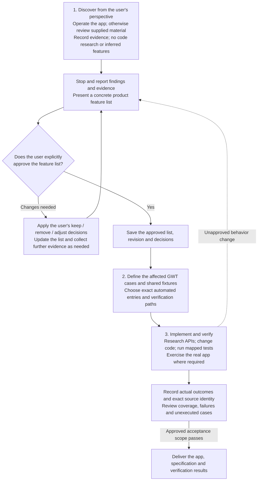

# App development workflow

This workflow covers new apps and changes to existing apps. A new reference-based app follows the discovery and approval process below. For an existing app, an explicit user request approves that requested change: record it against the current product specification, investigate only the affected behavior, and ask about unresolved choices or additional scope. Do not repeat approval for an already approved change. A request to investigate first authorizes investigation, not implementation.



**Mandatory order:**

1. Observe and record the reference product from the user's perspective, without reading implementation code or inferring features. Stop to report the findings and evidence, revise the product feature list with the user, and obtain their explicit approval.
2. Before implementation, update the affected GWT cases, expected outcomes and shared fixtures. Identify each canonical automated entry and the required execution environment. Select relevant existing regressions, including failures or blocked scenarios.
3. Research implementation, change the code and automation, execute the selected cases, and publish observed results for the exact tested source. Review the delivered behavior against the approved scope.

Do not implement an unapproved feature or change code before defining its affected cases and fixtures. Tests may develop alongside implementation after this preparation. A source change invalidates earlier acceptance for the changed inputs; a passing build is not a passing interaction test.

## Stage 1 — Discover features and collect evidence

Act as a user or product practitioner exploring the reference app, or analyzing and consolidating the available valid material. This stage must produce a clear, concrete product feature list that meets the user's requirements. It is the foundation for all later development and acceptance, and requires the user's review and confirmation.

**Collect real, accurate information from the user's perspective. Do not inspect source code, decompiled bundles or internal implementation in this stage. Do not infer features, interactions or expected results from code, common conventions, prior experience or the new app's behavior.**

Choose the evidence method according to what is available:

| Available reference | Required work | What the evidence establishes |
|---|---|---|
| A runnable app | Actually operate the app through user-accessible entry points. Exercise normal paths, relevant states, boundaries, errors and interactions, including basic features. Record the actions and observed results for every scenario. | A scenario is collected only after its real user interaction and behavior evidence have been recorded. Documentation, supplied screenshots, direct calls to internal APIs and code analysis cannot substitute for operating the available app. |
| Screenshots, text or videos only | Inspect all supplied material from the user's perspective and record only features, interactions and results explicitly shown or described. Cite the relevant image, passage, frame or timestamp. | Evidence is limited to the supplied material. Mark anything not shown or described as unknown; do not invent missing behavior or claim to have operated an unavailable app. |

- Record the reference identity, version/environment where known, supplied materials, relevant settings, initial state, actions and outcomes. If references are mixed, record the evidence type per scenario and operate every applicable behavior available in the runnable app.
- Build the inventory through user-facing exploration of the requested product scope. Cover elementary functions as carefully as complex functions, including entry points, hover controls, selection and focus states, visual feedback, keyboard and pointer interactions, and resulting content changes. Expand observed features into concrete scenarios rather than listing only screens or feature names.
- For many scenarios or complex behavior, organize records by product area/module, feature and workflow, then by state, boundary condition or interaction variant where useful. Maintain an index and stable feature/scenario identifiers. Avoid one unstructured document or an unexplained pile of attachments.
- Record reproducible starting data, actions, intermediate checkpoints and observable expected outcomes. Preserve screenshots, recordings or structured data when they establish the result. Record performance baselines and extension behavior when they are part of the product requirements.
- Keep unverified questions and candidate scenarios separate from collected features. Every collected scenario must point to its actual interaction evidence or, for material-only references, the exact supporting material. A generated scenario list, inferred expected result or passing test in the new app does not establish reference behavior or discovery completeness.
- Prepare the proposed product feature list, interaction specification and acceptance expectations from this evidence for user review. Record gaps and unknowns explicitly; do not fill them with assumptions. Any change the user requests for the new product must be recorded separately from the reference behavior. Defer implementation research until after approval; Stage 2 prepares acceptance and Stage 3 implements it.
- **Store all Stage 1 features and evidence inside the final app project.** Markdown documents with image/data attachments are an acceptable format. Use relative links and keep the files under version control so the delivered project retains the evidence independently of external issues or chats.

**Final step — stop and review with the user.** Report the analysis, observed behavior, evidence links, coverage and remaining uncertainties, and present the organized, concrete product feature list. Let the user decide which features to keep, remove or adjust. Revise the list, clarify expected behavior and collect further evidence where needed; repeat this review until the user explicitly confirms that the list meets their expectations. Do not start Stage 2 or implementation research while that confirmation is pending. Silence, elapsed time or approval of unrelated work is not approval of the feature list.

Keep the reference inventory and evidence intact. Save the reviewed product feature list, keep/remove/adjust decisions, final expected behavior, links to the reference scenarios, and the user's approval of that specific revision in the project. Mark approved deviations as product decisions, never as observed reference behavior. Removed features remain in the decision record but are outside implementation and acceptance scope. The approved list is the shared baseline for both later stages.

**Completion condition:** the full scoped reference inventory is reviewed and every collected scenario has a complete evidence-backed record. For a runnable reference, all required user interactions and evidence capture must be complete; unexecuted or partially observed scenarios remain incomplete. For material-only references, all supplied material must be reviewed, every recorded reference feature and result must have direct support, and unknowns and evidence limits must be explicit. Do not count inferred behavior as collected evidence or treat the number of proposed scenarios as proof of completeness. The final product feature list must have concrete expected behavior, no unresolved gap that prevents implementation or acceptance of its approved scope, and the user's explicit approval of its recorded revision. Evidence collection alone does not complete this stage.

## Stage 2 — Prepare cases, fixtures and the verification plan

- Map the approved change to existing feature IDs and case IDs. Amend the existing case when behavior changes; add a case for a distinct scenario. Record which removed or merged cases are superseded and where their useful assertions remain. Never remove a case merely because it fails or is difficult to run.
- Apply the case and fixture contract in Stage 3 **before implementation**. Include the expected starting state, observable outcomes, relevant boundaries, failure behavior and exact verification entry. Keep the specification independent of what the current code happens to do.
- Choose the smallest test scope that proves the change and its relevant regressions. Keep unit, integration and full-app claims separate. Record selected case IDs, why they apply, required fixtures, environment and known blockers. Include related failed or skipped cases.
- For a regression, reproduce the old failure when feasible, retain its result, then verify the fix. For visual or performance changes, define measurable geometry, interaction sequences, workload and comparison conditions before testing. For example, improving list speed must also preserve scroll position, selection and reachability of all rows.

**Completion condition:** affected behavior, GWT cases, fixtures, canonical test entries and the execution plan are concrete and reviewable. Expected results are not copied from the implementation under test.

## Stage 3 — Implement, maintain automation and verify

- Start implementation after the applicable product approval and Stage 2 preparation are complete.
- At this stage, use all available implementation details as technical references. For locally installed apps, inspect their application packages or bundles, metadata, dependencies, bundled code, configuration and resources. For web apps and desktop apps that wrap web content, use developer tools to inspect their code, DOM and styles, available source maps, network behavior and runtime execution. Source repositories, technical documentation and other available implementation materials can also inform the work.
- Record the reference version, source locations, useful findings and any unavailable details. Use this research to prepare the implementation plan and guide architecture, dependency choices and implementation techniques. The approved product feature list remains the behavior baseline; implementation research does not establish or replace Stage 1 product behavior evidence.
- Implement every retained or adjusted feature and scenario against the approved Stage 1 list and its final expected behavior. Do not reintroduce removed features or change the approved scope on your own.
- Associate implementation work with the product feature/scenario identifiers. Meet the specified platform, integration, extension, performance and delivery requirements.
- Keep the Stage 1 documents and attachments in the app project throughout development. Keep implementation details separate from the evidence of what the reference does.
- If a missing scenario, ambiguous requirement or contradiction is discovered, return to Stage 1 and complete the affected discovery and specification before proceeding. Report any proposed scope or behavior change and obtain the user's approval of the revised list before implementing it. Do not invent acceptance expectations from the new app's current behavior.

### Case and fixture contract

Prepare items 1–2 before implementation, then keep the case documents and data synchronized with approved changes. Apply this contract to all code projects, including projects without a graphical app.

1. Maintain a categorized **Given–When–Then (GWT) case document set** in the app project. Cover every retained or adjusted feature and scenario in the user-approved Stage 1 list without omissions, and identify the approved revision. Every Then expected result must align with the corresponding Stage 1 evidence; where the user explicitly approved different product behavior, link that decision and assert its approved result without claiming reference parity. Each case must have a stable, unique `caseId`, a feature/scenario reference, evidence and applicable decision references, and explicit Given, When and Then statements. Record relevant environment, state, data and intermediate checkpoints. Preserve whether the evidence came from actual app interaction or supplied screenshots, text or video, including its limits; do not turn unknowns or inferred behavior into acceptance expectations. Removed features do not require acceptance cases.
2. Prepare fixture data in the GWT documents before writing the tests. Prefer machine-readable JSON/YAML blocks that tests can load directly. For large datasets, binary files or shared fixtures, keep one canonical data attachment in the project and reference it from the GWT case. Avoid separately maintained copies in documentation and test code.
3. Maintain a one-to-one mapping between **every GWT case** and its canonical automated acceptance test entry, with the exact `caseId` in the test name, for example `[TASK-CREATE-001] Create a task`. Each acceptance test must identify its corresponding GWT case unambiguously; unrelated case IDs must not be bundled into one aggregate passing test. Distinct acceptance scenarios need distinct case IDs. Repeated runs across environments are executions of the same case, with their environments reported separately.
4. Have tests load the documented fixture block or referenced data file, perform the GWT actions and assert the documented outcomes. A small project loader/parser may expose the data to the test framework. Derived data must be regenerated from that source; expected values must never be copied from the app's actual output to make a test pass.
5. Use the required interaction level: real app/browser/system interaction for user-facing behavior that depends on it, with supporting unit/API/component tests where useful. Supporting tests and large runner totals do not replace case-level acceptance coverage.
6. Execute every selected case at its required level and environment. For a new app or a claim of complete product acceptance, run the full approved acceptance scope. For a focused maintenance change, record its impact-based selection and do not claim untouched historical cases were rerun. Save actual reports, mappings and source/input identities. Unexecuted, partial, skipped, stale or failing cases remain unaccepted. Verify performance and integration requirements under the agreed conditions.

**Acceptance completion condition:** every case in the declared acceptance scope has its corresponding named automated entry and passes for the tested source. The user-approved product feature list, feature coverage, reference evidence, approved adjustments, GWT expectations, shared fixture data, test names and result reports agree. No required case or unresolved failure is omitted from the final result.

## GWT and shared fixture example

The following is a case inside a project's GWT Markdown document. The evidence identifier is illustrative; a real case must point to an actual Stage 1 record.

### TASK-CREATE-001 — Create a task

- Feature: `TASK-CREATE`
- Evidence: Stage 1 record `TASK-CREATE-OBS-001`
- Given: the task list equals `fixture.initialState.tasks`.
- When: the user enters `fixture.input.title` and confirms task creation.
- Then: the task list equals `fixture.expected.tasks`, including task count, title and completion state.

```json
{
  "caseId": "TASK-CREATE-001",
  "fixture": {
    "initialState": { "tasks": [] },
    "input": { "title": "Buy milk" },
    "expected": {
      "tasks": [{ "title": "Buy milk", "completed": false }]
    }
  }
}
```

The test named `[TASK-CREATE-001] Create a task` loads this block by `caseId` and uses its initial state, input and expected data directly. Editing the fixture updates the data consumed by the test; there is no second handwritten fixture object in the test file.

## Repository organization and consistency

Use a structure appropriate to the product's size. For example:

```text
docs/
  reference/
    index.md
    <module>/features.md
    <module>/evidence/
  product/specification.md
  acceptance/
    index.md
    <module>.md
    fixtures/
tests/
  acceptance/
verification/
```

Maintain traceability in both directions:

`reference feature/scenario and evidence → user-approved product feature list and decision/revision → GWT caseId → documented fixture → named automated test → result for the delivered revision`

Consistency checks must detect unapproved scope changes, missing coverage of approved features/cases, duplicate case IDs, missing or unknown case IDs in acceptance test names, broken evidence/decision/fixture links, data divergence and stale results. Generated summaries must derive from the approved product feature list, maintained documents and actual reports.


## Operate the workflow for each change

1. **Specify.** Update the approved behavior and affected GWT cases first. Prepare canonical fixture inputs and exact automated entries. Record the selected cases and rationale before running them.
2. **Implement.** Change code and mapped tests. Keep small single-use inputs inline; store long, shared or full-app inputs once in versioned fixtures. Copy writable fixtures into an ignored run directory. Never use personal or production data for development acceptance.
3. **Identify.** Snapshot the inputs before each build/run: base commit, dirty status, and a deterministic fingerprint covering source, dependency locks, build configuration, tests, cases, fixtures and verification scripts. Save the file manifest. Exclude only documented outputs such as generated result summaries and ignored run artifacts. Compare the snapshot again after the build/run; if inputs changed, retain the run as historical and rerun affected cases against a stable snapshot. A commit SHA alone does not identify a dirty build.
4. **Execute.** Run the relevant automated suites and the required real-app flows. A hosted control, mocked service or WebKit component is an integration test, even when it displays a window. Full-app tests must operate the assembled app through its real entry points. Record platform/tool versions, app identity/path and executable hash; keep fixture copies and artifacts tied to that run. Reuse the project's fixed Preview identity and close it after verification.
5. **Record.** Import only actual reports. Validate known case IDs, unique results, source/build identity and evidence paths; reject mismatched reports. Preserve failure attempts, suite exit codes and skip reasons. An interrupted run must not fabricate results for unfinished cases. Keep unexecuted cases as `—`; leave previous outcomes and tested identities intact for cases not rerun.
6. **Review and submit.** Check the diff against the request, case coverage, fixture links and test mapping. Publish concise case results before committing. Aim to pass every relevant case; if a case remains blocked or failing, explain the exact reason, impact and remaining work in the PR and delivery report. Do not report complete acceptance. Follow the project's commit/PR rules and existing merge authorization; do not invent a Git hook or an all-pass commit gate. Existing repository protections still apply.

Run tests where their dependencies actually exist. Native macOS window, input-method and app-lifecycle tests usually need a logged-in graphical macOS session. CI is useful only when it can execute the required checks reliably. If testing is local, document exact commands and preserve its evidence; do not describe historical CI failures or successful builds as current app results. An environment limitation requires a specific diagnostic and next step, not an unexplained skip.

## Case files and result records

Use stable IDs rather than filenames or execution order as identity. A compact per-case format is:

| Field | Content |
| --- | --- |
| ID | `TASK-CREATE-001` |
| Verification | Exact command/selector or exported automated function containing `TASK-CREATE-001` |
| Given | Starting state and a link to the approved feature/evidence or its indexed specification |
| When | Reproducible user actions or API calls, including intermediate checkpoints |
| Then | Observable expected outcomes, including persisted effects where applicable |
| Level | Unit, Integration or End-to-end |
| Path | Local script, CI, Preview app, Release app, or the project's documented equivalent |
| Data | Inline for small single-use inputs, otherwise a link to canonical fixture data |

Keep execution status out of the case definition. Maintain one index grouped by product area and one concise current result summary. A practical layout is:

```text
docs/product/                 # Approved behavior and reference evidence
docs/testing/test-guide.md     # Environments, exact commands and troubleshooting
docs/testing/test-cases.md     # Schema and categorized case index
docs/testing/cases/<ID>.md     # GWT definitions; no mutable status
docs/testing/local-test-result.md
Tests/Fixtures/<area>/         # Canonical source inputs and expected data
Tests/<suite>/                # Unit/integration test entries
scripts/acceptance/            # Real-app automation and evidence checkers
build/<run>/                  # Ignored reports, logs, screenshots, fixture copies, bundles
```

These names are examples, not mandatory tooling choices. Use the project's language and test framework; avoid maintaining parallel result systems that describe the same current runs.

A result row needs `caseId`, `status`, source fingerprint, base commit and evidence or a failure/skip reason. The raw run metadata additionally records the run ID/time, environment, suite exit status, tested app/build identity, input manifest and artifact locations. Example machine-readable case output:

```json
{
  "caseId": "TASK-CREATE-001",
  "status": "Passed",
  "sourceFingerprint": "<sha256-of-input-manifest>",
  "baseCommit": "<git-commit>",
  "runId": "<unique-run>",
  "evidence": ["<run>/execution.json", "<run>/created-task.png"]
}
```

Use `Passed` only after all documented assertions complete; `Failed` for an observed violation; `Skipped` for a specific unmet prerequisite; and `—` for no execution. A checkpoint is partial evidence, never a pass. Freshness is separate from outcome: a past pass remains a past pass with its original identity, and does not certify changed source. Result-only publication must not change the source fingerprint.

Check both directions: every active case has exactly one canonical automated entry and every such entry identifies an active case. Repeated environments/runs are separate observations of the same ID. Check missing/duplicate IDs, selectors, fixture links and source identities automatically where practical. A prose instruction saying “inspect the app” is a procedure, not an implemented automated entry; record that gap honestly until automation exists.

During cleanup, trace callers and dependencies before deleting scripts or tests. Remove retired publication paths, duplicated assertions and temporary process notes when they have no current purpose; keep durable product decisions and meaningful regression coverage. Retain historical results as clearly labelled records, or a concise archive with the original identity, rather than keeping executable machinery solely to regenerate an obsolete format. Report what was removed or consolidated and why.
